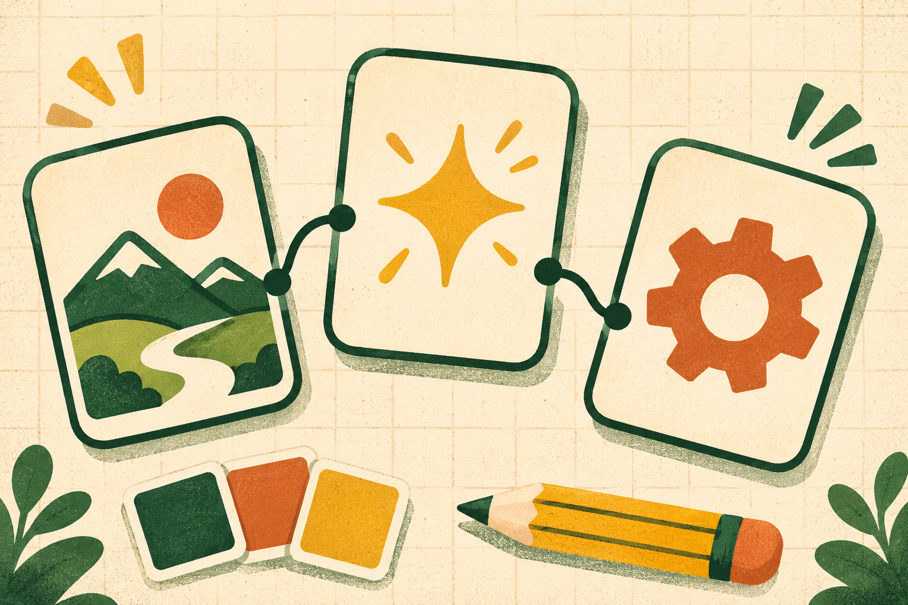

# TCG TableForge



**Turn a game world into playable ideas.** TCG TableForge is a local-first design canvas for tabletop and trading card game concepts. Start with a world or a gameplay hook, capture ideas as cards, and connect them as the design takes shape.

## What you can do

- Create projects with a **World-first** or **Mechanics-first** starting point.
- Capture ideas as **World**, **Experience**, **Theme**, **Mechanic**, or **Question** cards.
- Connect cards with relationships such as *Supports*, *Expresses*, *Creates Tension With*, and *Depends On*.
- Search, filter, and sort your cards, then switch between Board and List views.
- Import and export projects as JSON, or export a readable Markdown outline.
- Use the app offline after its first successful load. The service worker caches the app shell and offers an update flow.
- See connection and save state in the workspace footer. Project data is stored in this browser and is not synchronized.
- Explore the sample project or use the illustrated How To guide to learn the workflow.

## Run locally

The app is a static web app with no package installation or build step. Serve the project directory over localhost so the browser can use the service worker:

```sh
python3 -m http.server 8000
```

Then open [http://localhost:8000](http://localhost:8000). Data is saved in that browser's local storage. Use **Files → Export JSON** to create a backup before clearing browser data or moving to another device.

## Data and privacy

Projects stay in the current browser on the current device. There is no account, cloud sync, or server-side project storage. JSON import is validated before a project is added; exports are manual, so keep a backup somewhere safe if the work matters.

Clearing this browser's site data may delete local projects. The in-app **Clear all data** action also removes every project stored by TableForge in this browser after a confirmation step.

## GitHub Pages

TableForge is made from static files and can be hosted with GitHub Pages. The repository still needs a Pages Actions workflow and repository Pages settings before it can be deployed. The [release checklist](RELEASE_CHECKLIST.md) covers the recommended build/deploy workflow, project-site path checks, offline/update checks, accessibility, and release verification.

## Release readiness

The interface and core flows are prototyped. Automated tests, cross-browser acceptance checks, the Pages workflow, and the remaining release gates are tracked in [RELEASE_CHECKLIST.md](RELEASE_CHECKLIST.md). The checklist should be completed before describing the app as release-ready.

## Project files

- `index.html` — application UI, styling, and client-side behavior.
- `manifest.webmanifest` — install metadata.
- `sw.js` — versioned offline app-shell cache and update handling. Increment `CACHE_VERSION` for each release.
- `icon.svg` — TableForge app icon.
- `icon-tabletop-anvil.svg` — alternate icon concept.
- `assets/readme/tableforge-thumbnail.png` — generated README thumbnail.

## License

No license has been selected yet. Until one is added, normal copyright restrictions apply.
